# 视频分析 · 《从脑洞到剧本！AI编剧全流程实操，新手也能写出爆款剧本（附编剧Skill）》

> **UP主**：DeepWhite深白色 ｜ **BV号**：BV1KtHD6kEme ｜ **时长**：22分01秒 ｜ **分析日期**：2026-10-29
> **双轨来源**：whisper small 本地转写（[transcript.srt](./transcript.srt)，有错字，术语已按屏显帧校正）+ 场景感知抽帧 67 帧（[frames.tsv](./frames.tsv)）。
> **屏显文字核验方式**：帧由两个只读子代理经本机 OCR 双引擎交叉提取，本文所有「屏显」术语以帧上原文为准；语音转述标注 `[t=mm:ss]`，帧引用标注来源注释。
> **随课 Skill**：**两支血统均已入库**——①`.agents/skills/screenplay-fullflow/`（夸克 38期 `编剧全流程SKILL/` 七件，Flova 六道版）；②`.agents/skills/deepwhite-screenwriting-v1/`（38期 `deepwhite-screenwriting-v1.0.1.zip` 解包，**视频里豆包演示的真身**，屏显名一致；附 examples/第一集《壶盖》剧本.md 成稿样例）。出处登记见 [../SOURCES.md](../../SOURCES.md)——视频里上传到豆包的技能屏显名为 **「Deepwhite Screenwriting V1」**。

---

## 执行摘要

这期视频用一条"双穿越三国"的 14 字对话点子（刘禅让诸葛亮看烧水、诸葛亮反手一句"材料科学没有基础"），在**豆包工作台**上完整演示了怎样用随课 Skill（Deepwhite Screenwriting V1）把脑洞走成 3 分钟短剧剧本。方法论四步——**破题（定故事核心）、扩展（补人物与情节）、落地（写动作台词）、检查（审逻辑节奏）**——在 Skill 里落成逐步推进的工序：破题与核心动作 → 梗概草稿 → 人物深度与弧光 → 背景完善 → 结构大纲/分场大纲 → 正式写作 → 剧本医生诊断。最值得带走的三件事：①破题阶段"AI 出方案、人做关键决策"的协作节奏（UP 主亲手注入"两人都是穿越者"核心概念并要求改开场钩子）；②【剧本医生诊断报告】展示了句级精确的 P0/P1/P2 修改优先级（时长超标本着台词字数逐段统计）；③两个验证小技巧——16 宫格分镜图和 Seed Audio 广播剧，用最低成本"预览"剧本成片效果。UP 主收尾点破本质：Skill 提供步骤和检查，**决定剧本好坏的是工作逻辑与审美**。

---

## 主题 × 时间段目录

| # | 主题 | 起止 | 跳转 |
|---|---|---|---|
| 一 | 方法论总览：四步框架 + 树的比喻 | 00:55–04:31 | [看](https://www.bilibili.com/video/BV1KtHD6kEme?t=55) |
| 二 | 案例点子：双穿越三国的 14 字对话 | 01:44–02:30 | [看](https://www.bilibili.com/video/BV1KtHD6kEme?t=104) |
| 三 | 实操环境：豆包工作台 + Skill 安装 | 04:37–05:46 | [看](https://www.bilibili.com/video/BV1KtHD6kEme?t=277) |
| 四 | 第1步 破题：两版迭代 + 开场钩子修订 | 05:48–10:07 | [看](https://www.bilibili.com/video/BV1KtHD6kEme?t=348) |
| 五 | 第2步 梗概草稿 + 气质锚点 | 10:07–10:39 | [看](https://www.bilibili.com/video/BV1KtHD6kEme?t=607) |
| 六 | 第3步 人物深度与弧光（五维标签） | 10:39–12:58 | [看](https://www.bilibili.com/video/BV1KtHD6kEme?t=639) |
| 七 | 背景完善：死期、玄学与历史修正力 | 12:58–14:40 | [看](https://www.bilibili.com/video/BV1KtHD6kEme?t=778) |
| 八 | 第4步 结构大纲→分场：四节拍 + 因果链 | 14:40–15:32 | [看](https://www.bilibili.com/video/BV1KtHD6kEme?t=880) |
| 九 | 正式写作 + 剧本医生（P0/P1/P2） | 15:32–17:14 | [看](https://www.bilibili.com/video/BV1KtHD6kEme?t=932) |
| 十 | 小技巧：16 宫格分镜图 + 广播剧 | 17:14–18:44 | [看](https://www.bilibili.com/video/BV1KtHD6kEme?t=1034) |
| 十一 | 广播剧台词实录（成片文本） | 18:44–20:38 | [听](https://www.bilibili.com/video/BV1KtHD6kEme?t=1124) |
| 十二 | 收尾观点：审美与积累才是核心 | 20:38–22:01 | [看](https://www.bilibili.com/video/BV1KtHD6kEme?t=1238) |
| 十三 | 视频流程 ↔ 本仓六道工序对照 | — | — |
| 附 | whisper 错字校正表 | — | — |

---

## 一、方法论总览：四步框架 + 树的比喻

开场立论：AI 短剧的红利期进入淘汰赛，画面精美只是入场券，**决定播放与变现的核心是剧本**——UP 主自述做过一条 700 万播放短剧，没拼特效，靠的是"情绪的起伏抓人 + 反转卡在观众猜不到的节点" `[t=00:18]`。新手的最痛点不是没点子，而是写出来像流水账、没有情绪起伏 `[t=00:38]`。

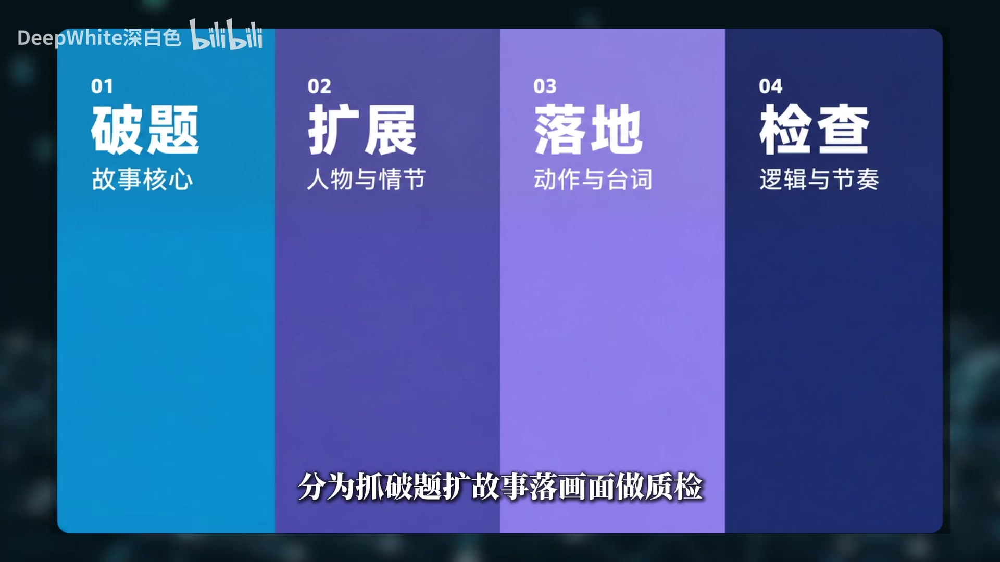
<!-- 来自 frame_0001 · 01:28 -->

方法论总纲是四步卡片（屏显原文）：**01 破题·故事核心 ／ 02 扩展·人物与情节 ／ 03 落地·动作与台词 ／ 04 检查·逻辑与节奏** `[t=01:22]`。Skill 的完整流程比四步更细：破题、梗概、人物、前史、世界观、结构、分场、场景写作，以及最后的诊断和评分 `[t=03:02]`——但新手不需要记这些名字，跟着走就行。

两个反复强调的创作观：

1. **树的比喻** `[t=03:57]`：主干（表达什么、往哪走、要哪些情节）是作者的，AI（豆包）帮忙整理信息、在主干上补枝叶；Skill 提供推进方法和检查门槛。
2. **选择权在你** `[t=04:19]`：AI 可能想出更好的方向，哪些采用、哪些舍弃，一定要有自己的想法——讲解页专门做了一页「选择权，在你／采用／舍弃」示意图。
<!-- 来自 frame_0012 · 04:32 -->

## 二、案例点子：双穿越三国的 14 字对话

案例不是文字，是 UP 主先做的一段小动画 `[t=01:40]`（屏上大字「蜀」）：

> 刘禅：**"我穿越了，穿谁不好穿成了刘禅，就是那个乐不思蜀的，按理说地狱开局……别人穿越带系统，我带一脑子历史，这局稳了。"**
> 刘禅："相父，您看这个炉子，水被烧开了，盖子就会被顶起来。"
> 诸葛亮："**我知道，但是材料科学没有基础，蒸汽机做不出来。**"

`[t=01:46–02:12]`（whisper 把「刘禅」转成"刘善"、「乐不思蜀」转成"乐不私属"，已校正）

UP 主被这个点子击中的原因说得很清楚：**一开始觉得好笑，再想一想又有点无奈** `[t=02:19]`——这个"好笑→无奈"的情绪双拍，就是后面所有设计的靶心。

## 三、实操环境：豆包工作台 + Skill 安装

演示平台是**豆包工作台**（不是 Flova 网页端；夸克原包的 00 总控文件里自述站内名「编剧SKILL全流程」、Flova 广场可搜，视频里则把同一套文件以 **「Deepwhite Screenwriting V1」** 之名上传到豆包）。

- **安装路径** `[t=04:37–04:58]`：豆包底部「更多技能 → 技能管理 → 右上角添加 → 上传技能」，把 Skill 文件拖进来；装好后在「更多技能」里启用。（安装弹窗那帧动态模糊，按钮名以旁白为准，屏显仅能实证「更多技能」「插件」两个入口。）
<!-- 来自 frame_0014 · 04:41 -->
- **模型**：会话右下角模型选择器屏显「**豆包 2.1 Pro 高**」。
- **Skill 开场两问**（屏显原文）`[t=05:24]`：
  1. 你想做什么？完全从零构思一个新故事，还是已有材料（梗概/分场/剧本片段）需要诊断或修改？
  2. 体量是哪种？1-3 分钟概念片 / 5-10 分钟短片 / 长片 / 多集剧集？
<!-- 来自 frame_0019 · 05:24 -->

UP 主的选择逻辑值得抄：想做成可延续的长线故事，但**第一集不铺那么大，先把第一集做好**——所以输入「从零创作。3 分钟短片，是一个多剧集的第一集。点子：……」`[t=05:17–05:43]`。
<!-- 来自 frame_0021 · 05:36 -->

## 四、第1步 破题：两版迭代 + 开场钩子修订

破题是全片演示最细的一步，完整展示了"AI 出稿 → 人判断 → 注入决策 → AI 重出"的循环。

### 4.1 UP 主先私下拆点子（人做方向决策）

`[t=06:11–06:52]` 刘禅为什么让诸葛亮看烧水？——他是穿越者，想点拨最聪明的人发明蒸汽机。那诸葛亮一开口就懂材料科学，说明什么？两个方向：**①诸葛亮也是穿越者；②他是古人，知识来自更早穿越者的遗产**。UP 主选了①（这一步纯口头分析，无屏显帧，只记意图）。

### 4.2 第一版破题 + 用户注入核心概念

第一版输出的高概念（屏显）：

> 蜀汉宫苑，被史书记为"扶不起"的皇帝，从一壶沸水看见了蒸汽时代；被史书称为"多智近妖"的丞相，用一句"材料科学没有基础"，亲手按灭了那扇门。

<!-- 来自 frame_0024 · 06:57 -->

随后 UP 主在消息里**亲手注入核心概念**（屏显原文）：「核心概念是：二人都是穿越者，刘禅是天真的以为无脑穿越开挂，而现实是即使穿越也很难改变。而诸葛亮是更早的穿越者，早都知道这点，再找回去的方法」——这是"主干归作者"的现场示范。
<!-- 来自 frame_0026 · 07:19 -->

### 4.3 第二版破题（完整结构）

第二版（屏显，AI 用时 40 秒）结构非常整：

- **高概念**：两个穿越者在三国相遇：一个以为穿越是开挂，一个知道穿越是牢笼。
- **戏剧动作**：目标（刘禅用"蒸汽常识"证明"我是穿越者+我能开挂"）／阻碍（诸葛亮精准拆穿，且知道"这条路走不通"的全部理由）／结果（开挂梦当场碎裂，结尾翻出更大钩子——诸葛亮一直在找回去的路）。
- **功能定位（剧集视角）**：单集事件=两人第一次互相摊牌；**主题锚点**="知识碎片≠改变历史的能力。知道'水开顶盖'的人，造不出蒸汽机"；季钩子=诸葛亮找回去的方法。
- **关键创作决策（供你确认或推翻）**：①视角主角选刘禅（观众跟着天真进入、跟着幻灭离场）；②炉子是全片核心视觉符号（蒸汽顶盖="看似能推动、实则推不动"的隐喻）；③对白驱动的双人戏（3 分钟、一个空间、台词就是动作）。
- **【自检要点】** + 「请回复"通过"进入下一步（梗概草稿）」。

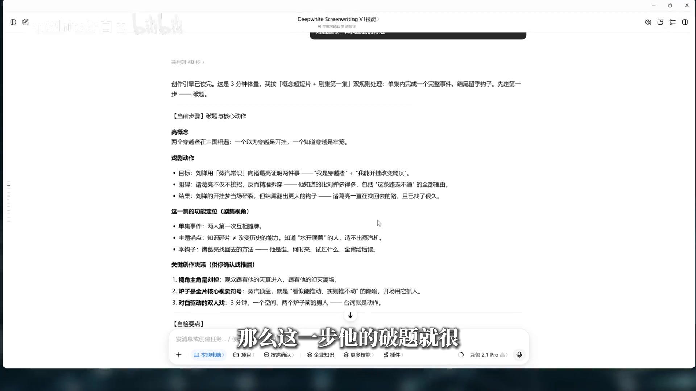
<!-- 来自 frame_0027 · 08:02 -->

### 4.4 UP 主否掉开场，要求短剧式改法

第一版自检里"前 5 秒建立好奇"过关了，但 UP 主不认：开场只是"水开了"的画面不够抓人 `[t=08:39–09:05]`，要求**短剧式开头——一开场就已经穿越了，不拍穿越之前，用自述开剧情**。修订版（屏显）：

- **开场设计：自述入场**——黑场，刘禅声音先出："我穿越了"；画面随自述亮起，快速交代三件事（穿成了谁／处境／他的计划）；自述在他兴冲冲要展示"第一个发明"时被掐断，进入正戏。
- **预期曲线**（屏显原文）：**"又是穿越爽剧"（前15秒）→"等等，诸葛亮怎么知道蒸汽机？"（30秒内反转）→"那他这些年经历了什么？"（季钩子）**。
- **钩子的真正杀招：自述被当场掐断。**

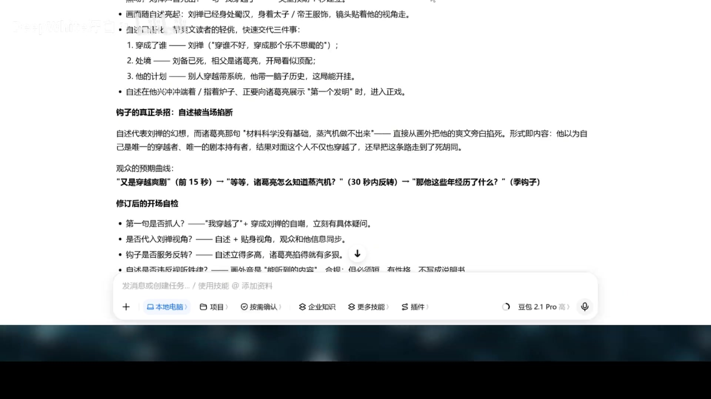
<!-- 来自 frame_0029 · 09:08 -->

UP 主顺带给了长短剧口径的分界 `[t=09:30]`：短剧用字幕/自述解释设定是**有效**打法；长篇则要靠画面铺垫、少用旁白——那才是更高级的做法。

## 五、第2步 梗概草稿 + 气质锚点

通过破题后进入「梗概草稿」（注意：whisper 把它转成"竞改草稿"，屏显原文是**梗概草稿**）。一段话完成「做梦→梦醒→新悬念」全走向（屏显梗概全文见帧），关键结构：刘禅带一脑子历史要开挂 → "蒸汽机"三个字让爽文剧本当场作废 → 诸葛亮把刘禅能想到的路全走过一遍（火药、炼钢、牛痘、曲辕犁，每一样死在同一堵墙上）→ "一个人脑子里的知识，撑不起一整个工业文明" → 结尾"找回去的路"+ 案头星图与不属于这个时代的物件。

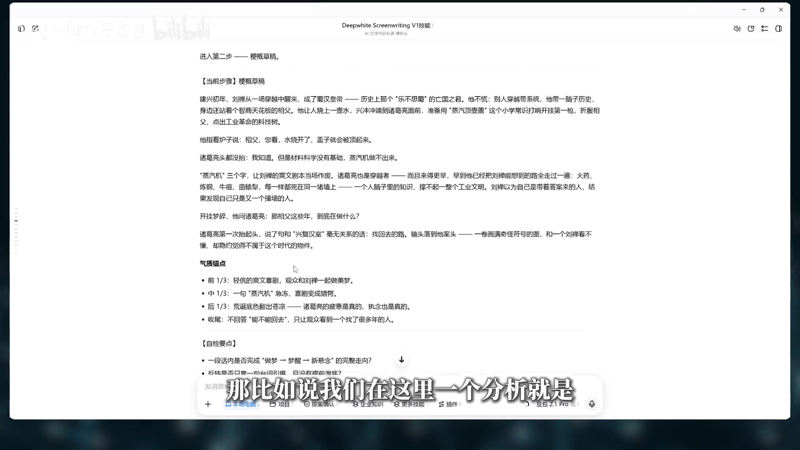
<!-- 来自 frame_0032 · 10:14 -->

**气质锚点**（屏显原文，whisper 误作"气质矛点"）四条就是全片情绪曲线设计：

- 前 1/3：轻佻的爽文喜剧，观众和刘禅一起做美梦。
- 中 1/3：一句"蒸汽机"急冻，喜剧变成错愕。
- 后 1/3：荒诞底色翻出苍凉——诸葛亮的疲惫是真的，执念也是真的。
- 收尾：不回答"能不能回去"，只让观众看到一个找了很多年的人。

## 六、第3步 人物深度与弧光（五维标签）

人物卡用好莱坞编剧通用的五维标签（屏显）：**Want／Need／Lie／Flaw／Ghost** ＋ 本集 Arc。要点 `[t=11:14–11:39]`：刘禅穿越前是普通青年、"知道的很多，但样样都不精"（whisper"不惊"校正），相信现代知识降维打击、自己是天选主角；Flaw=**轻浮、想走捷径**（whisper"亲服"校正）；Ghost 标签=人物的过去经历。本集转变弧：轻挑自信 → 被"蒸汽机"三个字打懵（whisper"打闷"校正）→ 看见前辈无数失败 → **开挂梦碎**。

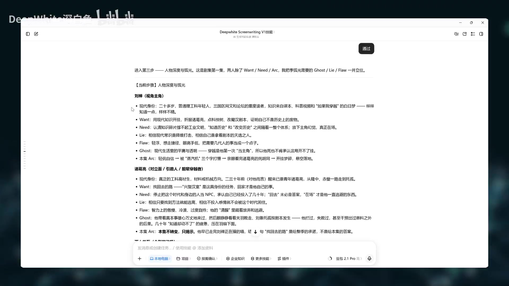
<!-- 来自 frame_0035 · 11:05 -->

诸葛亮：理工科背景、来得更早、尝试过也失败过；一手担着诸葛亮身份的责任，一手想回家——"这两件事放一起，人物才有意思" `[t=12:11–12:29]`。屏显特别标注：**本集不转变，只揭示**。

最精彩的是「两人关系（全剧发动机）」（屏显原文）：

- 表层：君臣，相父与皇帝。
- 深层：仅有的两个同类，却是"前辈与新人"。
- **关键镜像：刘禅就是几十年前的诸葛亮。**
- 知识层次的反差即主题：刘禅是"民科级的乐观"（知道原理就敢想），诸葛亮是"专家级的绝望"（正因为真懂，才知道差着一整个工业体系）。

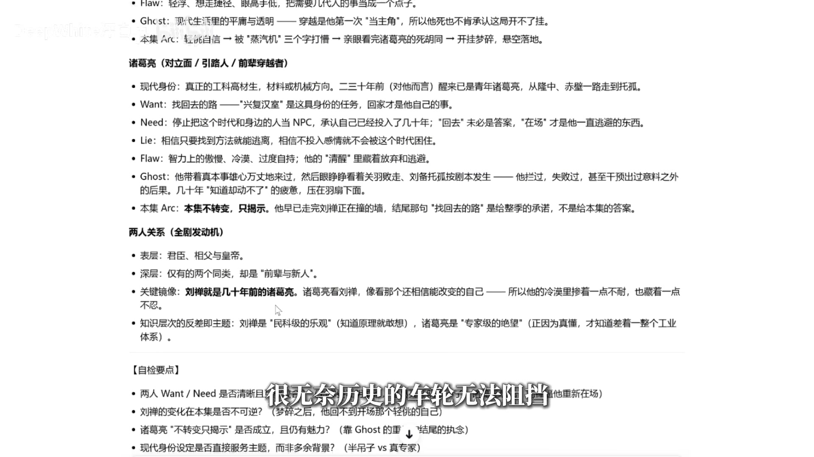
<!-- 来自 frame_0037 · 12:50 -->

自检要点也硬：刘禅的变化在本集是否**不可逆**（梦碎后回不到开场的轻挑）？诸葛亮"不转变只揭示"是否成立且仍有魅力？现代身份设定是否直接服务主题而非多余背景？

## 七、背景完善：死期、玄学与历史修正力

这一段（对应流水线第 3 道"世界观"，视频里无屏显帧，全靠语音）展示的是**第一集克制、给长线留钩子**的思路 `[t=12:58–14:22]`：

- 要定的底子：穿越机制怎么设、时代怎么选、穿越者诸葛亮的**失败前史**有哪些、为什么失败。
- 隐性爆点：**穿越者诸葛亮知道自己的死期——234 年五丈原**（whisper"五丈云"校正），留给后续剧情引爆 `[t=13:16]`。
- 深层问题（第一集不答、长篇必须答）：诸葛亮既然也知道历史，为什么历史还是发生了？是尝试失败，还是这个世界本身有**历史修正的力量**？`[t=13:33]`
- 回去的方向：以《三国演义》为底，**借东风、七星灯**这些演义自带的玄学元素与穿越设定有接续空间——留下，但不急着塞进第一集 `[t=14:00]`。

## 八、第4步 结构大纲→分场：四节拍 + 因果链

结构大纲（屏显）按"3 分钟 ≈ 180 秒、**一个空间、一场连续戏、内部四节拍**"来搭：

| 节拍 | 时段 | 情节/情感 |
|---|---|---|
| ① 自述入场 | 0–20s | 松／轻 |
| ② 急冻 | 20–55s | 骤紧／轻转中（激励事件："蒸汽机"三个字） |
| ③ 死胡同 | 55–145s | 中／重，**错位：平静讲解，底下梦碎** |
| ④ 钩子 | 145–180s | 季钩子立起 |

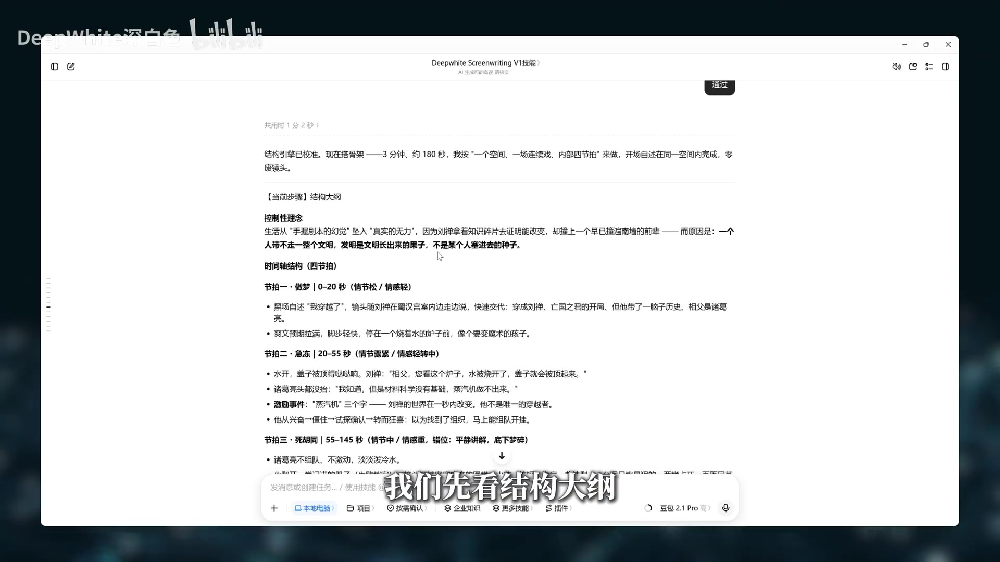
<!-- 来自 frame_0041 · 14:40 -->

UP 主在此强调全片最重要的节奏观 `[t=14:47]`：**剧情不能一直平淡、也不能高开低走，要过山车式起伏，不断打破观众预期**。分场大纲则是把结构大纲再细化一遍，并对因果链做一次检查 `[t=15:07]`。

因果链检查的口径（屏显）值得原样抄走——**"因为"不是"然后"**：

> 因为刘禅自述自信 → 他才敢端炉子去"考"诸葛亮。因为他用"顶盖"试探 → 诸葛亮才回"蒸汽机"，暴露身份。因为发现前辈在场 → 他狂喜求组队。因为求组队 → 诸葛亮才摊开失败档案。因为档案封死所有路 → 他才追问"那你在做什么"。因为这一问 → 才翻出"找回去的路"。**环环相扣，无废场。**

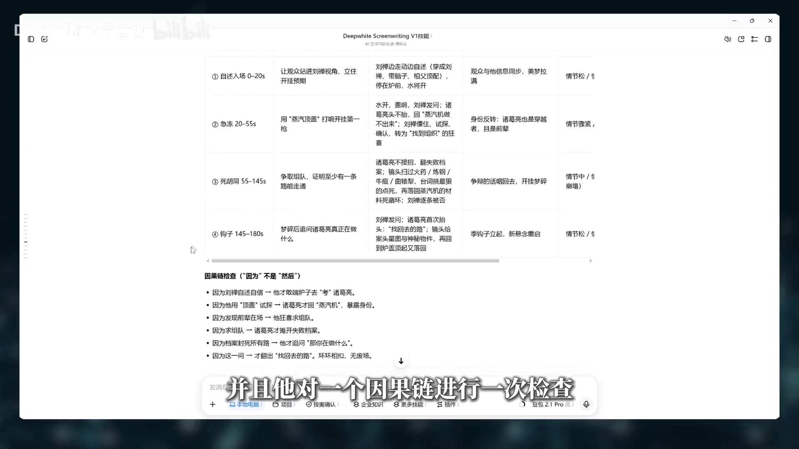
<!-- 来自 frame_0042 · 15:13 -->

## 九、正式写作 + 剧本医生（P0/P1/P2）

正式写作一步把台词、动作、场景全部写出 `[t=15:36]`；随后进入**「剧本医生」**诊断（whisper 转成"剧本一生"，屏显为【剧本医生诊断报告】）。这份报告是全视频最能体现 Skill 价值的产物（屏显）：

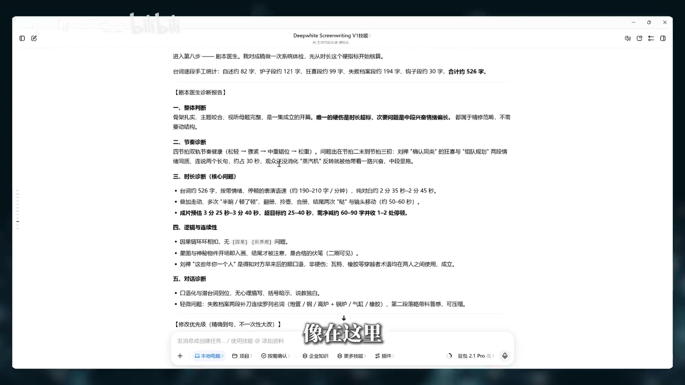
<!-- 来自 frame_0043 · 15:55 -->

- **一、整体判断**：唯一的硬伤是时长超标；次要问题=中段兴奋情绪偏长。
- **二、节奏诊断**：四节拍双轨节奏健康（松轻→骤紧→中重错位→松重）。
- **三、时长诊断（核心问题）**：**台词逐段手工统计**——自述约 82 字、炉子段约 121 字、狂喜段约 99 字、失败档案段约 194 字、钩子段约 30 字，合计约 526 字；纯对白约 2:35–2:45，成片预估 3:25–3:40，**超目标 25–40 秒，需净减约 60–90 字并收 1–2 处停顿**。
- **四、逻辑与连续性**：因果链环环相扣；**星图与神秘物件开场即入画、结尾才被注意=合格的伏笔（二刷可见）**；瓦特、橡胶等穿越者术语均在两人之间使用，成立；口语化与潜台词到位，无心理描写、括号暗示、说教独白。
- **五、对话诊断** + **【修改优先级（精确到句，不一次性大改）】**：
  - **P0·解决超时**（建议全做，净减约 55–60 字）：4 条句级压缩，如"狂喜段合并：'卧槽——相父，不是，同志！可算找着组织了！'"、"瓦特句压缩"、"补刀第二段压缩"、"你是皇帝段压缩"。
  - **P1·节奏**：随 P0 自动改善。
  - **P2·可选**（为第二集留抓手）：让指尖在星图某个位置停半秒——给一个不解释的视觉钩子。
  - 下一步指令：**回复"按 P0 改"，我出精修定稿**。

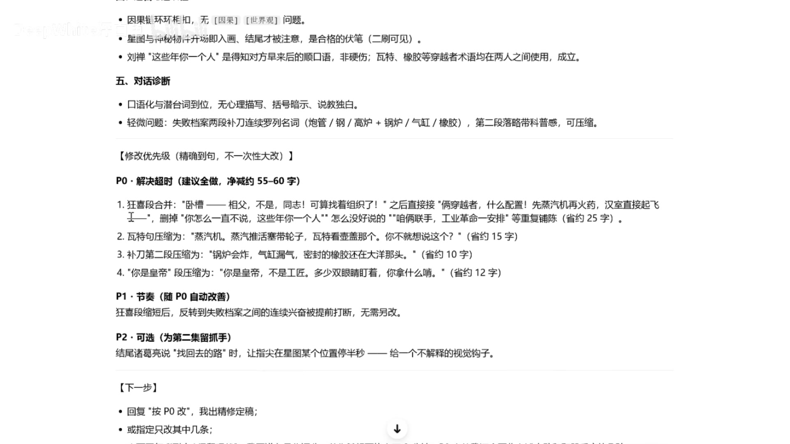
<!-- 来自 frame_0045 · 16:39 -->

UP 主对"时长超标"的现场判断也很专业 `[t=16:24]`：剧本文本层面超标是事实，但实际拍摄带导演思维后节奏会更压缩（whisper"悲伤"系"压缩"误转），那是后面生成视频环节的事。最后 AI 给量化评分，UP 主提醒：AI 评分没那么精细，**只当参考** `[t=17:03]`。通过后生成完整文档（核心概念、人物、世界观、剧本正文、评分）。

## 十、小技巧：16 宫格分镜图 + 广播剧

两个"用最低成本预览成片"的技巧：

1. **16 宫格分镜图** `[t=17:26]`：豆包新建页面 → 更多技能 → 图像模型（语音转写为"CG5.0 Pro"，屏显未能确证该名；技能面板可见 Seedance 2.5 / Seed Audio 1.0 / AI MediaKit 条目）→「按照以下剧本生成 16 宫格分镜图」。产物为一镜到底 12 拍分镜（格题：刘禅入场→凑近观察→发现规律→平静反应→笑容僵住→解释原理→震惊确认→兴奋提议→翻看手稿→现实的墙→悬念收束），UP 主强调：**不求画面精确、不纠逻辑 Bug，感受的是故事效果** `[t=18:02]`；不同图像模型出的效果不同，可以换着试。
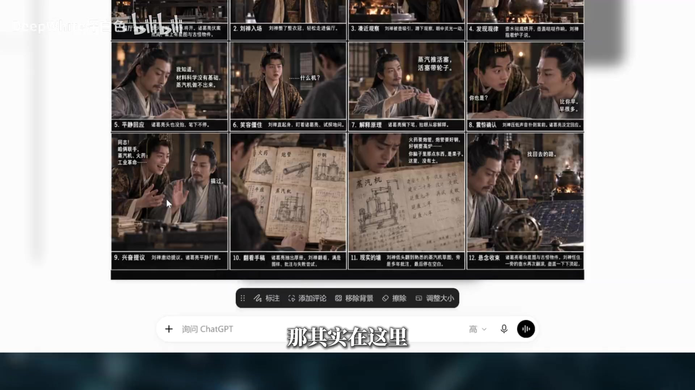
<!-- 来自 frame_0063 · 21:00 -->
2. **广播剧** `[t=18:14]`：豆包工作 → 更多技能 → **Seed Audio 1.0**（屏显：面向有声书、播客、影视配音等音频创作场景，原生直出 2 分钟的人声&音乐&音效复合音频）→ 把剧本生成广播剧，配合分镜图一起"看片"。
<!-- 来自 frame_0062 · 20:31（帧时间以 frames.tsv 为准；烧录字幕属 21:00 段） -->

配合的成片画面（蜀字匾额书房、蒸汽铜壶、蒸汽机手稿与星图）在 18:31–20:31 段连续展示。

## 十一、广播剧台词实录（成片文本，18:44–20:38）

whisper 转写 + 帧上 P0 修改建议交叉校正后的定稿台词（这就是那部 3 分钟短剧的正文）：

> ——主角命。别人穿越带系统，我带一脑子历史，这局稳了。
> 相父，您看这个炉子，水被烧开了，盖子就会被顶起来。
> 我知道。但是材料科学没有基础，蒸汽机做不出来。
> ……相父刚才说什么机？
> 蒸汽机。烧开水，蒸汽推活塞，活塞带轮子。瓦特盯着壶盖看出来的那个。你不就想说这个？
> 卧槽——相父，不是，同志！可算找着组织了！你怎么一直不说，这些年你一个人？
> 没什么好说的。
> 怎么没好说的？俩穿越者，什么配置？咱俩联手，先蒸汽机，再火药，工业革命一安排，汉室直接起飞！
> 搞过。……自己看。
> （翻手稿）火药、炮管炸膛、气缸温度上不去、牛痘……这你都知道？
> 火药要炮管，炮管要好钢，好钢要高炉——你的蒸汽机还没有。锅炉会炸，气缸漏气，密封要橡胶，橡胶在大洋那头。全卡在同一处。
> 那就一样一样啃！一代人啃不动，两代人！
> 你是皇帝，不是工匠。一天几个时辰奏章，多少双眼睛盯着你，你拿什么啃？
> 我刚来那年，跟你一模一样——觉得一脑子学问，降维打击。后来才懂：**你脑子里那点东西是果子，这儿没有土。**
> ……那相父这些年，到底在做什么？
> **找回去的路。**
> 回哪儿？

`[t=18:44–20:31]`（"主角命/找着组织/好钢/大洋那头/啃"等处按屏显帧校正；"果子"帧上另存"菜子"疑读，以语音"果子"为正）

## 十二、收尾观点：审美与积累才是核心

`[t=20:38–21:40]` UP 主卸掉 Skill 神话：AI 帮收集信息、拓展思路、找到更多方向；豆包帮助整理、拓展、检查；Skill 让创作**有条理、有步骤**——但**不一定用 Skill 出来的剧本就更好**。可以用豆包自带的「短剧创作」「创意视频」技能，甚至不用 Skill 直接对话。**核心是这套工作逻辑 + 你的审美决定剧本好坏。**想写得更好没有捷径：多观察生活、多分析喜欢的作品、自己多写反复修改——这样和 AI 讨论时，才会越来越知道该问什么、该留什么。

## 十三、视频流程 ↔ 本仓六道工序对照

| 视频屏显步骤 | 时段 | 对应六道 | 备注 |
|---|---|---|---|
| 破题与核心动作（含开场钩子修订） | 05:48–10:07 | **① 概念锚定** | 高概念/戏剧动作/主题锚点 ↔ 定位菜单+一句话故事+核心主旨 |
| 梗概草稿 + 气质锚点 | 10:07–10:39 | ① 的产出扩充 | 对应 A 套「一句话故事」的展开段 |
| 人物深度与弧光 | 10:39–12:58 | **② 角色圣经** | Want/Need/Lie/Flaw/Ghost ↔ 八项角色卡；两人关系镜像 ↔ 镜像关系 |
| 背景完善（穿越机制/失败前史/死期/玄学） | 12:58–14:40 | **③ 世界观** | "第一集不塞满"= ③ 红线"每条设定要能落到某一场" |
| 结构大纲（四节拍）→ 分场大纲 | 14:40–15:32 | **④ 分场大纲** | 因果链检查 ↔ 逐场四问第 1 问；"无废场" ↔ 删除测试 |
| 正式写作（台词/动作/场景） | 15:32–15:47 | **⑤ 剧本深度融合** | 屏显正文即"台词就是动作"的双人戏 |
| 剧本医生（诊断+评分） | 15:47–17:14 | **⑥ 压力测试** | P0 句级压缩=病灶在⑤的局部修；诊断报告格式 ↔ 审计输出模板 |

两点差异值得知道：视频里每步的【自检要点】+「通过」指令，就是六道「判门」的现场形态；而**版本台账与病灶回退表（总控 4.6）在视频里没有演示**——那是 Skill 文件里更强的结构，长项目里靠它避免"一律从头重做"。

## 附：whisper 错字校正表（语音 → 正字，依据）

| 转写错字 | 正字 | 依据 |
|---|---|---|
| 逗包/斗包/兜包 | 豆包 | 帧屏显（工作台首页/模型选择器） |
| 刘善/流善 | 刘禅 | 帧屏显（人物卡） |
| 柱格亮/猪格亮 | 诸葛亮 | 帧屏显 |
| 竞改草稿 | 梗概草稿 | frame_0028/0032 屏显 |
| 气质矛点 | 气质锚点 | frame_0032/0033 屏显 |
| 主旨谋点 | 主题锚点 | frame_0027 屏显 |
| 真气机 | 蒸汽机 | 多帧屏显 |
| 乐不私属 | 乐不思蜀 | 语义 |
| 剧本一生 | 剧本医生 | frame_0043 屏显 |
| 五丈云 | 五丈原 | 史实 |
| 界东风 | 借东风 | 语义（演义） |
| 民主里面 | 名著里面 | 语义 |
| 通过字数开启剧情 | 通过自述开启剧情 | frame_0029 屏显 |
| 样样都不惊 | 样样都不精 | 语义 |
| 亲服 | 轻浮 | 语义（人物 Flaw） |
| 打闷/闷碎 | 打懵/梦碎 | frame_0037 屏显（"梦碎"） |
| 降为打击 | 降维打击 | 语义 |
| 炸糖/炒缸/牛豆/肯 | 炸膛/气缸/牛痘/啃 | frame_0042（火药/炼钢/牛痘/曲辕犁） |
| 大洋内头 | 大洋那头 | frame_0044 P0 条屏显 |
| 短句/爽具/流水仗 | 短剧/爽剧/流水账 | 语义 |
| 时长更加悲伤 | 时长更加压缩 | 语义 |
| 查漏不缺 | 查漏补缺 | 语义 |
| 功课图片/16功课 | 宫格图片/16宫格 | frame_0063 屏显 |
| C'd Audio 模型 | Seed Audio 1.0 | frame_0062 技能面板屏显 |
| CG5.0 Pro（图像模型名） | **存疑** | 帧上未见该名，未确证 |
